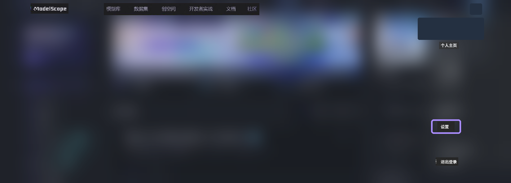
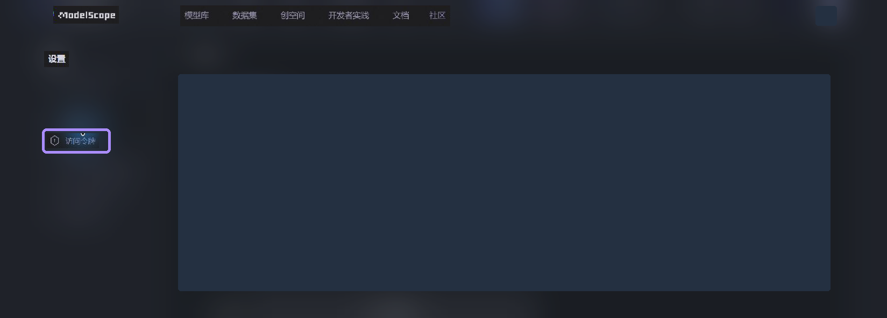
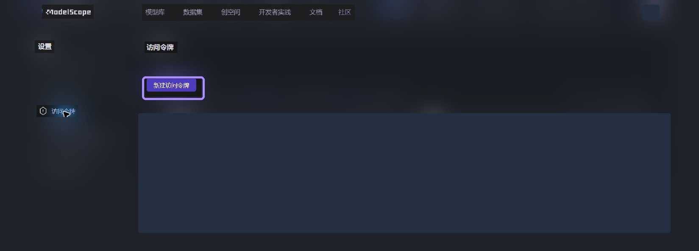
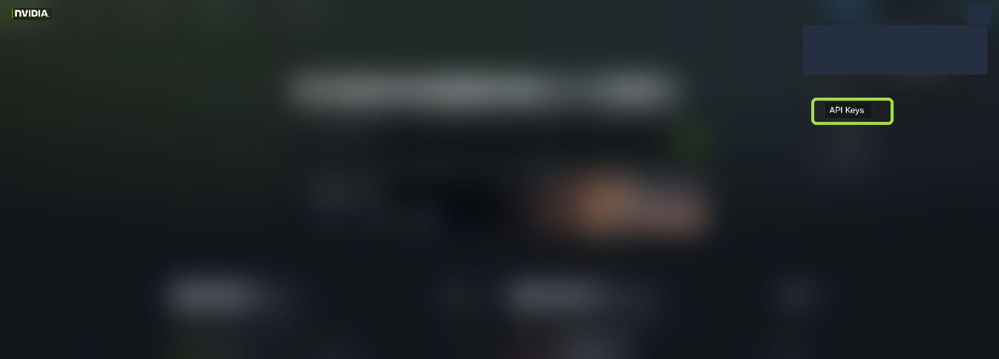
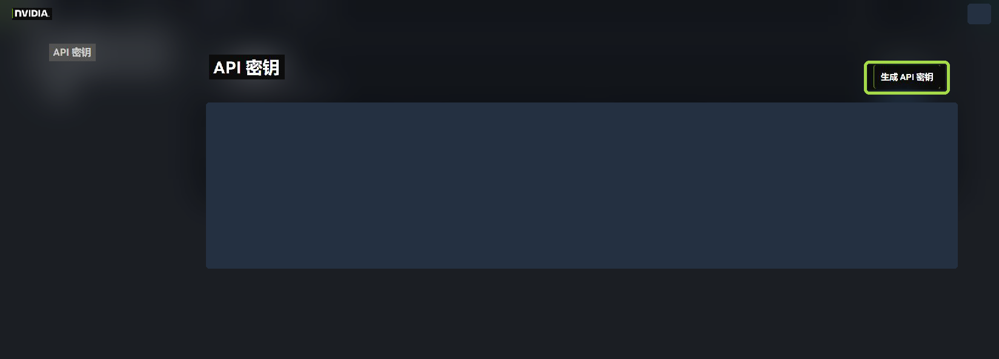

# Chat Demo API Key 配置图文教程

API Key 是用来调用模型服务的密钥。先在服务商网站创建自己的密钥，再填到 Chat Demo 的 **设置 → 数据管理**。下面以登录后的实际页面为例，截图里的账号和密钥区域已遮挡。

- [魔搭 ModelScope：获取访问令牌，使用 DeepSeek](#魔搭-modelscope)
- [NVIDIA NIM：获取 API Key，从可用模型中选择](#nvidia-nim)
- [把密钥填进 Chat Demo](#把密钥填进-chat-demo)

## 魔搭 ModelScope

1. 打开 [魔搭社区](https://modelscope.cn/)，点击右上角 **登录 / 注册**。按网站提示登录，成功后右上角会显示头像。
2. 点击右上角的**头像**，在展开的菜单中点击 **设置**。

   

3. 在设置页左侧点击 **访问令牌**。登录后也可以直接打开 [访问令牌页面](https://modelscope.cn/my/myaccesstoken)。

   

4. 点击 **新建访问令牌**，按页面提示创建，然后复制生成的令牌。如果页面提示完成账号绑定或认证，按魔搭的页面指引操作。

   

## NVIDIA NIM

1. 打开 [NVIDIA Build](https://build.nvidia.com/)，点击右上角 **Login（登录）**。按网站提示登录 NVIDIA 账号。
2. 回到 NVIDIA Build，点击右上角的**头像或账号图标**，在菜单中选择 **API Keys（API 密钥）**。登录后也可以直接打开 [API Keys 页面](https://build.nvidia.com/settings/api-keys)。

   

3. 点击 **Generate API Key（生成 API 密钥）**，按页面提示创建，然后复制完整的密钥。NVIDIA 的密钥以 `nvapi-` 开头。

   

## 把密钥填进 Chat Demo

1. 打开 Chat Demo，点击 **设置**，再点 **数据管理**。
2. 在 **模型后端** 里选与你拿到的密钥对应的服务。魔搭令牌选 **ModelScope**，NVIDIA 密钥选 **NVIDIA NIM**。第一次使用时，Base URL 可以留空，应用会使用对应的官方地址。
3. 把刚才复制的完整密钥粘贴到 **API Key** 输入框，点 **确定**。在部分桌面界面也可以按回车确认。
4. 想通过魔搭使用 DeepSeek，可以先试应用预填的 DeepSeek 模型。使用 NVIDIA 时，从 **NVIDIA 聊天模型** 下拉菜单选一个当前可用的模型。如果界面仍显示模型 ID 输入框，可以留空先试默认模型。
5. 关闭设置，点击 **开启新对话**，发一句「你好，请用一句话介绍你自己」。收到回复就说明配置已跑通。

如果 NVIDIA 在网页上提示直连失败，可以回到 **数据管理 → 连接方式** 选择 **使用转发** 再试。若提示密钥无效，先核对所选后端和完整密钥。可用模型和试用额度以服务商页面为准。

把密钥只填在设置里的 **API Key** 输入框。复制和截图时留意遮挡密钥，避免公开分享。
